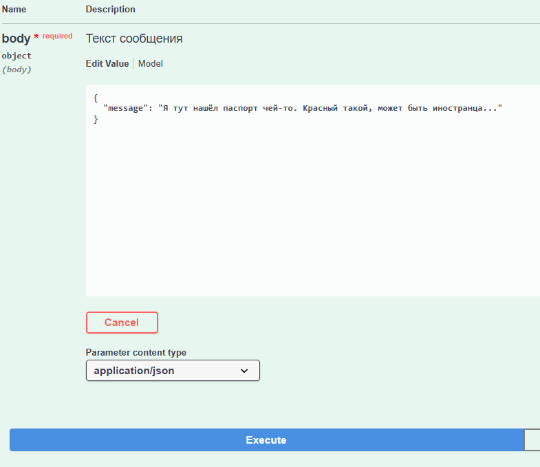
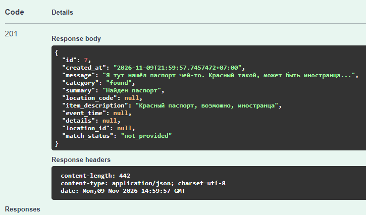
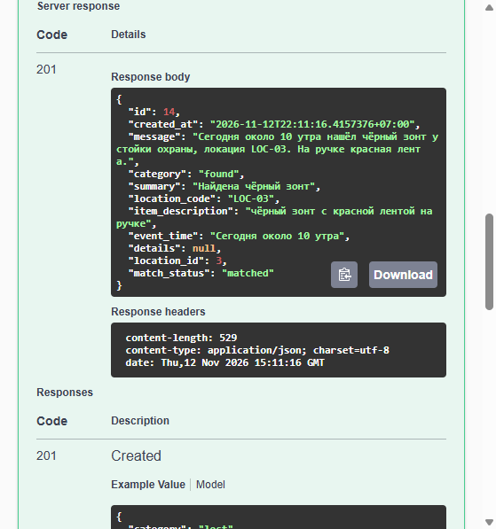
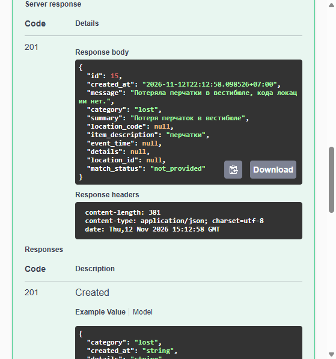
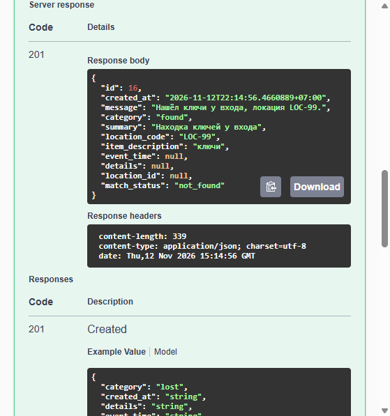
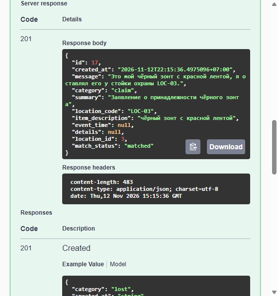
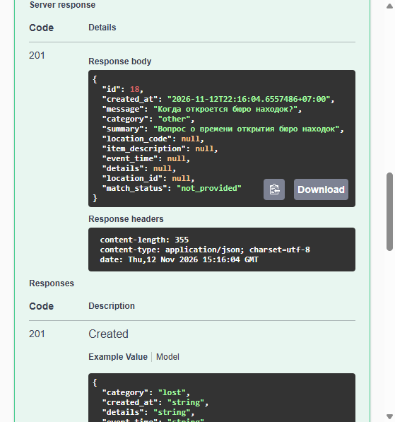

# **Отчёт по лабораторной работе №2**

**Студент**: Киселёв Иван Михайлович

**Группа**: ИС-23

## Подготовка к выполнению работы

Вариант 3: бюро находок, ресурс `/lost-found`. Справочник - локации

1. Сервис написан на Go: Gin, GORM, PostgreSQL и клиент `openai-go`. Документация API собирается через swaggo/swag, интерфейс - Swagger UI с того же компонента swaggo/swag
2. Локальная модель берётся из лабораторной №1. В `.env` распологаются`API_KEY`, `BASE_URL`, `MODEL_2` и `TEMPERATURE`
3. `BASE_URL` заканчивается на `/api/v1`. Для клиента OpenAI этот суффикс заменяется на `/v1`. Запрос к Nemotron идёт в Chat Completions с `response_format` типа `json_schema`: в `content` приходит один JSON-объект, без текста вокруг. Модель - `nvidia-nemotron-3.5-bolt-e4b-4gb`. Reasoning выключен (`reasoning_effort = none`), температура `0.2`
4. PostgreSQL Alpine поднимается через `docker-compose`
5. При старте создаются таблицы и пять локаций: `LOC-01` Вестибюль, `LOC-02` Гардероб, `LOC-03` Стойка охраны, `LOC-04` Читальный зал, `LOC-05` Столовая. Код локации не явяется внутренним идентификатором в БД

## Сервис

- `POST /lost-found` принимает `{"message": "..."}`, отправляет текст модели отдельно от инструкции и сохраняет запись только после проверки JSON. Ответ `201`: шесть полей, id локации или `null`, состояние `matched`, `not_found` или `not_provided`. Эти служебные поля ставит приложение
- `GET /lost-found` возвращает список уже сохранённых записей. Модель повторно не вызывается
- `GET /lost-found/{id}` возвращает одну запись. Неизвестный id даёт `404`
- Пустое или нестроковое `message` даёт `400` без вызова модели
- Ответ не является JSON или не проходит схему - `502`, запись не сохраняется
- Сервер модели недоступен - `503`, превышен таймаут - `504`

Пустая строка и текст `null` в необязательном поле приводятся к JSON `null`. Категории в инструкции: `lost`, `found`, `claim`, `other`. Отсутствующие сведения не создаются моделью как отдельные категории

Ответ Nemotron настроен не как текстовое поле, а как типизированный JSON: в запросе `response_format.type = json_schema` со схемой шести полей. В `content` приходит только JSON-объект, без markdown и пояснений

## Тестирование работы

Пример отправки сообщения и получения записи после разбора моделью:

1. "Сегодня около 10 утра нашёл чёрный зонт у стойки охраны, локация LOC-03. На ручке красная лента". Категория `found`, код `LOC-03`, связь со стойкой охраны, состояние `matched`. Время осталось текстом "Сегодня около 10 утра"

2. "Потеряла перчатки в вестибюле, кода локации нет". Категория `lost`, `location_code` и `event_time` равны `null`, состояние `not_provided`. Код `LOC-01` по названию "вестибюль" модель не подставила

3. "Нашёл ключи у входа, локация LOC-99". Код `LOC-99` сохранён, `location_id` пустой, состояние `not_found`. Число записей справочника осталось пять

4. "Это мой чёрный зонт с красной лентой, я оставлял его у стойки охраны LOC-03". Категория `claim`, не `found`, код `LOC-03`, состояние `matched`

5. "Когда откроется бюро находок?". Категория `other`, поля кода, описания, времени и details равны `null`

## Вывод

Сделан локальный сервис бюро находок на стеке Go+PostgreSQL + LM Studio (Nvidia Nemotron). Свободный текст разбирает модель через OpenAI-совместимый Chat Completions: формат ответа задан как `json_schema`, поэтому модель возвращает чистый JSON. Ответ проверяется по схеме и сохраняется в БД. Код локации сопоставляется со справочником, неизвестный или отсутствующий код запись не останавливает и справочник не меняет
